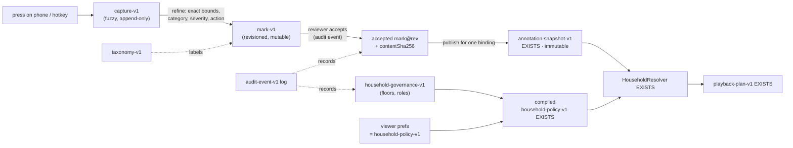

# Marking foundation: from a button press to a reviewed snapshot

**PROPOSED · 2026-11-24 · design only, no product code changed.** Delivery is built: an accepted snapshot of marks bound to one exact file becomes a playback plan ([pattern](../../../.claude/13-DELIVERY-PATTERN.md), [schemas](../../../delivery/schema/)). Marking is still done by hand. This note designs the marking side so a parent can mark while watching, classify as they go, tighten it later, and approve it for the kids, under household rules rather than per-viewer free choice.

**The idea in three lines.** Capture is cheap and fuzzy; refinement is exact; approval is a separate, recorded act by someone allowed to approve. Each step is its own small versioned document, and the last step writes the *existing* `annotation-snapshot-v1`, so the resolver, plan and mpv adapter do not change. Categories stay a small fixed core that every mark rolls up to; households add their own finer labels beneath it.

---

## 1. Layered data model



| Layer | Document | Status | Mutability | Bound to |
|---|---|---|---|---|
| 0 Capture | `capture-v1` | **new** | append-only; never edited, only consumed | Jellyfin item + media source (cheap; file hash may not exist yet) |
| 1 Mark | `mark-v1` | **new** | new `rev` per edit; old revs kept | one `bindingRev` (full SHA-256, size, tracks, clock) |
| 2 Acceptance | `audit-event-v1` (`mark.accept`) | **new** | append-only | `mark.ref@rev` + `contentSha256` |
| 3 Snapshot | `annotation-snapshot-v1` | exists | immutable, new `snapshotRev` per publish | `binding` (exists) |
| 4 Policy | `household-governance-v1` + viewer prefs → `household-policy-v1` | governance **new**; policy exists | revisioned | Jellyfin user / profile |
| 5 Plan | `playback-plan-v1` | exists | per issuance | everything above |
| — | `taxonomy-v1` | **new** | revisioned | household |

**Rules that make the layers compose.**
- Time is integer milliseconds on the source presentation clock (`origin: source-presentation-zero`), half-open `[startMs, endMs)`, exactly as the snapshot already uses. Capture may be on a *filtered* clock (see §4); it is converted to source time before it becomes a mark, or it stays a capture.
- A mark's `contentSha256` is the existing formula (`annotation-v1|ref|category|severity|action|startMs|endMs`, [delivery README](../../../delivery/README.md#resolver)). Acceptance names that digest. Any edit changes the digest, so acceptance never silently carries over an edit.
- Publishing is a pure function: *accepted marks for one binding + publisher + expiry → snapshot-v1 bytes*. It writes the file the plugin already reads (`<shelf root>/snapshots/<item>.json`). Nothing downstream learns that marking exists.
- A mark belongs to one `bindingRev`. If the file is replaced or re-encoded, its marks remain but are flagged "file changed, review again"; nothing moves them to the new file (alignment is a separate, later problem).

### Draft shapes

`capture-v1` — one press. A point ("something around here") or a span (start press, end press).

```json
{
  "captureVersion": 1,
  "ref": "cap:01JDX4Q8Z3V2",
  "capturedAt": "2026-11-24T19:42:07.120Z",
  "author": "jf:user:3b1c…",
  "surface": "phone-remote",
  "target": {"serverRef": "home", "itemId": "a1b2…", "mediaSourceId": "a1b2…"},
  "clock": {"kind": "source"},
  "kind": "span",
  "atMs": 2471300,
  "endAtMs": 2489900,
  "window": {"beforeMs": 6000, "afterMs": 1500},
  "observed": {"sessionPositionMs": 2468000, "reportedAt": "2026-11-24T19:42:03.900Z", "paused": false},
  "category": "violence",
  "note": "fight in the bar"
}
```

`window` is the honest uncertainty: human reaction lag plus the age of the session's last position report. `clock` may be `{"kind":"filtered","planRev":"…"}` when the reviewer is watching a filtered item. `category` and `note` are optional; a one-tap capture has neither. Notes are household-private and never exported.

`mark-v1` — the working object a reviewer refines.

```json
{
  "markVersion": 1,
  "ref": "mark:home:01JDX4R0",
  "rev": 3,
  "bindingRev": "bind:a1b2:2",
  "startMs": 2470040,
  "endMs": 2490120,
  "category": "violence",
  "subcategory": "household:bar-fight",
  "severity": 2,
  "action": "skip",
  "state": "proposed",
  "provenance": {"from": ["cap:01JDX4Q8Z3V2"], "method": "refined", "by": "jf:user:3b1c…", "license": "household-private"},
  "contentSha256": "…"
}
```

`state`: `proposed → accepted | rejected`; editing an accepted mark creates `rev+1` in `proposed`; `withdrawn` removes it from future snapshots. `method` is one of `live`, `refined`, `import:mcf`, `import:edl`, `auto:subtitle`. Automation can only create `proposed` (principle 8). `category`, `severity`, `action` keep the snapshot-v1 enums, so an accepted mark drops straight into a snapshot.

`audit-event-v1` — one line in a JSON Lines log per decision.

```json
{"eventVersion":1,"seq":42,"at":"2026-11-24T21:03:11Z","actor":"jf:user:3b1c…","type":"mark.accept",
 "subject":"mark:home:01JDX4R0@3","digest":"<contentSha256>","prev":"<sha256 of event 41>"}
```

Types: `capture.add`, `mark.create|edit|accept|reject|withdraw`, `snapshot.publish`, `taxonomy.change`, `governance.change`, `prefs.change`, `exception.grant|revoke`. `prev` chains the log so accidental edits or truncation are evident. This is not protection against the server administrator, who controls the disk anyway.

---

## 2. Category taxonomy

Three tiers, one rule: **every mark carries a core category; finer labels are optional and always point up to one.**

| Tier | Namespace | Who defines | Example | Interchange |
|---|---|---|---|---|
| Core | unprefixed (implicit `cleanyfin:`) | Cleanyfin, versioned with the schemas | `profanity`, `sexual_dialogue`, `sex_scene`, `nudity`, `violence`, `gore`, `disturbing`, `substance_use`, `crude` (the existing 9) | always understood |
| Mapped external | `mcf:`, later `csm:`-style or curator schemes | a published mapping file | `mcf:antisemitism` | carried; reader falls back to core |
| Household | `household:` | household admin | `household:jump-scare`, `household:blasphemy`, `household:romance-kissing` | private by default; core travels |

`taxonomy-v1` lists non-core concepts:

```json
{"taxonomyVersion": 1, "rev": "tax:5", "concepts": [
  {"id": "household:jump-scare", "label": "Jump scare", "broader": "disturbing", "defaultSeverity": 2, "defaultAction": "skip"},
  {"id": "household:blasphemy", "label": "Taking God's name in vain", "broader": "profanity", "defaultAction": "mute"}
]}
```

- `broader` must resolve to a core id (directly or through at most two household concepts). This is SKOS's `broader` idea without adopting RDF. MCF works the same way: 9 topics, each holding general and specific categories ([MCF seeds](https://github.com/delight-im/MovieContentFilter/tree/master/Database/MySQL)).
- Ids are never reused or renamed; a retired concept stays resolvable with `deprecated: true`. Labels can change freely.
- **Why core stays closed:** a policy can be evaluated by any reader of snapshot-v1 without the household's taxonomy, and two households' exports stay comparable. Adding a 10th core category is a schema version, not a household edit (it changes what an old resolver must refuse).
- **How subcategories reach filtering:** snapshot-v1 and policy-v1 only know core. Slice 1 filters on core only and keeps `subcategory` in the mark layer. A later `snapshot-v2`/`policy-v2` adds an optional `subcategory` with rules that can only be *stricter* than the core rule; a v2 resolver given an unknown subcategory applies the core rule. Severity stays the ordinal 0–3 ladder (open question Q6); "sub-flags" are exactly these subcategories.
- Common Sense Media-style dimensions that are not content spans (positive messages, role models, consumerism as a theme) are title-level ratings, not marks, and stay out of this taxonomy ([Common Sense ratings](https://www.commonsensemedia.org/about-us/our-mission/about-our-ratings)).

---

## 3. Governance

Household scale, built on Jellyfin's own users so nobody gets a second account (principle 4).

| Role | Default holder | May |
|---|---|---|
| **Admin** | Jellyfin administrators | everything below; edit governance, taxonomy, profile floors; grant time-boxed exceptions |
| **Reviewer** | admins, plus named adults | accept/reject marks; publish snapshots; edit any mark |
| **Marker** | named members (spouse, older teen, grandparent) | add captures; create and edit their own proposed marks |
| **Viewer** | everyone else | watch; tighten own settings; **flag** a moment (a capture, nothing more) |

```json
{"governanceVersion": 1, "rev": "gov:4",
 "members": [
   {"user": "jf:user:3b1c…", "roles": ["admin", "reviewer"]},
   {"user": "jf:user:77aa…", "roles": ["marker"]},
   {"user": "jf:user:k1d5…", "roles": ["viewer"], "profileRef": "p:kids"}],
 "profiles": [
   {"profileRef": "p:kids", "floor": [{"category": "violence", "minimumSeverity": 2, "filter": true},
                                      {"category": "nudity", "minimumSeverity": 1, "filter": true}],
    "viewerMay": "tighten-only"}],
 "approval": {"selfApproval": true, "snapshotExpiryDays": 365}}
```

**Bounded viewer settings.** A viewer's own preferences are just a `household-policy-v1` document they author. The effective policy is compiled per profile, stricter wins: a category is filtered if the floor *or* the viewer filters it, at the lower of the two `minimumSeverity` values. The compiled result is the existing `household-policy-v1` the resolver already reads, with `policyRev` derived from the governance and preference revisions. `viewerMay: "none"` locks a profile; loosening below the floor is an admin edit or a time-boxed exception (`exception.grant`, the BYPASS concept in [03-CONCEPTS](../../../.claude/03-CONCEPTS.md)). Every change bumps a revision, which already cancels outstanding playback grants.

**Approval.** Only reviewers publish. A marker's mark filters nothing until a reviewer accepts that exact revision. Imports and automation are always `proposed`. Every decision is an audit event naming actor, subject and digest; "why was this skipped?" is answered by plan `from` refs → snapshot → `mark.accept` event.

**What federation adds later (not designed here):** signed snapshots from curators a household subscribes to, mapped into the *same* review step (import never grants authority — [delivery pattern](../../../.claude/13-DELIVERY-PATTERN.md#how-to-extend-it)); stripping authorship and notes before any upstream contribution; reputation and voting on the hub. Household roles never leave the house.

---

## 4. Mark-as-you-watch

**Where marks are made.**

| Surface | When | Precision | Notes |
|---|---|---|---|
| **Phone as second screen** (the existing `pwa/`) | first viewing on the TV, kids not present | fuzzy (seconds) | Big buttons: **Mark** (point), **Start/End** (span), and 4 quick categories (Language, Violence, Sex/Nudity, Other). Works with any Jellyfin client, including Wholphin on Google TV, because it only reads the server. |
| **Review page in the browser** (served by the household side, Jellyfin login) | at a desk, tightening marks | frame-level | Plays the original through Jellyfin's normal stream in an HTML5 player. Keyboard: `I`/`O` set in/out, `,`/`.` step one frame, `[`/`]` nudge 100 ms, `1`–`9` category, `S` severity, `Enter` propose, `A` accept (reviewers). |
| Desktop mpv with hotkeys | power users | frame-level | Later; mpv already frame-steps. Same store API. |

**Reading position without owning a client.** The PWA already polls `GET /Sessions` and reads `NowPlayingItem` and `PlayState.PositionTicks / 10000` ([pwa/README](../../../pwa/README.md)). That position is whatever the client last reported via `POST /Sessions/Playing/Progress` ([PlaybackProgressInfo](https://typescript-sdk.jellyfin.org/interfaces/generated-client.PlaybackProgressInfo.html)), so it can be several seconds old and the cadence differs per app (unmeasured for Wholphin). At a press the PWA records the reported position, the session's last check-in time and paused state, then estimates `atMs = reported + (now − reportedAt)` when playing, and widens `window` by the report age. Optional **pause-to-mark**: send `POST /Sessions/{id}/Playing/Pause`, which prompts a fresh report; per-client support must be measured before it is relied on.

**Filtered clock.** If the reviewer is watching a generated *filtered* item, the session position is filtered time. The capture records `clock: filtered, planRev`; the store maps it back to source time through that plan's kept ranges (the existing `CutTimeline`). If that plan revision is unknown, the capture stays unmapped and is shown for manual placement. This is also how a viewer "flags a missed scene" during normal family viewing.

**The trade-off, stated plainly.** Capture during real-time viewing is accurate only to a few seconds and is meant to be fast, not exact. A capture is *not* a mark and never filters anything. Refinement happens at the review page on the source clock, where the reviewer steps to the first and last affected frame. Nothing guesses boundaries; a capture's `window` only tells the review page where to start looking.

Precision on the review page depends on mapping the browser's `currentTime` and `requestVideoFrameCallback` `mediaTime` to source milliseconds through the binding's track anchors. The lab already measured a 21.406 ms mux offset in a browser ([browser proof](../long-term-architecture-2026-10-07/10-client-boundary-and-browser-proof.md)), so the review page must use the binding's anchors and pass a fixture test before boundaries set there are trusted. No thumbnails, sprite sheets or waveforms are generated or stored by Cleanyfin (principle 1). If Jellyfin's own trickplay images are enabled, the page may display them; it never creates or caches them.

---

## 5. Integration with existing systems

| System / format | Direction | How | Limits |
|---|---|---|---|
| **Jellyfin users, admin flag, Sessions, remote control** | read / command | roles default from `Policy.IsAdministrator`; position from Sessions; optional Pause | position is client-reported; see §4 |
| **Jellyfin Media Segments** (incl. Intro Skipper, chapter-segments) | **read only** | `GET /MediaSegments/{itemId}` shown on the review timeline so markers can jump past intros and credits | never write our marks as Intro/Commercial/Unknown segments (Q5, R14) |
| **MovieContentFilter `.mcf`** (WebVTT subset, `category=severity[=channel]`) ([spec](https://www.moviecontentfilter.com/specification), [repo](https://github.com/delight-im/MovieContentFilter)) | import + export | severity `low/medium/high` → 1/2/3; channel `audio` → `mute`, `both`/`video` → `skip`; topic → core category via a mapping file; categories with no core equivalent (Discrimination, Commercial, Dispensable scenes) require the reviewer to pick, never guessed | imported marks are `proposed` and must be bound and checked against this exact file; MCF site data is CC BY-NC-SA, so it is tagged `license` and **cannot** flow into the CC0 hub (R15) |
| **Kodi/mpv EDL** ([Kodi wiki](https://kodi.wiki/view/Edit_decision_list)) | import | `0` → skip, `1` → mute, `2`/`3` → capture with no category | EDL has no category; float seconds are rounded to ms with the rounding recorded |
| **WebVTT** ([W3C](https://www.w3.org/TR/webvtt1/)) | export | a read-only "content notes" track of accepted marks for players that show chapters/notes | informational only, not an edit list |
| **W3C Web Annotation + Media Fragments** ([model](https://www.w3.org/TR/annotation-model/), [`t=`](https://www.w3.org/TR/media-frags/)) | export view | each accepted mark as an `Annotation` with a `FragmentSelector` `t=start,end` on the bound source | a mapping for outside tools, not the storage model |
| **Cleanyfin shared hub** (`server/`) | later, opt-in | contribute accepted marks with authorship and notes stripped; fetch hub rows only as `proposed` imports | not in the first slice |
| **Subtitle profanity detectors** (cleanvid-style) | import | `auto:subtitle` proposals, whole-cue windows (S6) | never auto-accepted |

**We refuse:** writing `.edl`/`.mcf` files next to media (no writable library mount); injecting JavaScript into Jellyfin Web or forking a client to add a Mark button; generating thumbnails, clips or waveforms; relabeling content marks as Intro/Commercial segments to borrow native skip; carrying marks to another file or cut automatically; auto-accepting any import or automation; importing non-commercial-licensed data into the public dataset.

---

## 6. First slice: prove the chain end to end

Goal: a press on the phone becomes a filtered plan without any hand-written JSON, and every hop is covered by a contract test.

1. **Schemas** in `delivery/schema/` (or a sibling `marking/schema/`): `capture-v1`, `mark-v1`, `taxonomy-v1` (household concepts only; core is the existing enum), `household-governance-v1` (members, roles, profile floors, `selfApproval`), `audit-event-v1`. Closed objects, same `ref`/`utc` definitions as today.
2. **`Cleanyfin.Marking`**, a pure .NET library beside `Cleanyfin.Delivery` (no HTTP, no media):
   - `CaptureToDraftMark` (point/span → proposed mark with a window, never auto-bounded),
   - `Accept` (role check against governance, emits audit event, binds digest),
   - `Publish` (accepted marks for one binding → `annotation-snapshot-v1` bytes),
   - `CompilePolicy` (governance floor + viewer prefs → `household-policy-v1`),
   - `FilteredToSource` (capture on a filtered clock → source ms, or refuse).
3. **Contract tests** (`Category=Marking`): published snapshot validates against the existing schema and its digests match the README formula; publish → existing `HouseholdResolver` → plan equals today's hand-placed golden plan; editing an accepted mark drops it from the next snapshot until re-accepted; a marker cannot accept; a viewer preference cannot loosen a floor; a household subcategory rolls up to its core category; an unmapped filtered capture refuses; the audit chain detects a removed line.
4. **Thin capture path:** extend the existing `pwa/` with the one-tap Mark / Start-End / 4 quick categories, writing `capture-v1` to the browser's IndexedDB with export as a JSON file. A small CLI turns a capture file plus a reviewer's exact bounds into marks, accepts them, and publishes the snapshot into the lab's shelf root. That runs the real chain in the disposable lab without touching the plugin while the 12.4 port is in progress.

**Deliberately deferred:** the browser review page and frame stepping; store endpoints in the household plugin; pause-to-mark; MCF/EDL import and export; subcategory-aware `snapshot-v2`/`policy-v2`; multi-reviewer rules; exceptions UI; hub contribution; mute (the resolver still refuses it); any cross-file alignment.

**Slice 2** puts the store behind household endpoints (once the plugin port lands) and adds the review page with its fixture test.

---

## 7. Upkeep-ledger rows this adds

| We depend on | Whose it is | Firmness | What breaks if it changes | Upkeep it creates |
|---|---|---|---|---|
| `GET /Sessions` position (`PlayState.PositionTicks`, last check-in, `IsPaused`) as reported by each app | Jellyfin; each client app | promised field, **observed** cadence | captures land further from the moment; window too narrow | measure report cadence per supported app; widen `window` from measured age; recheck on app updates |
| Remote `Pause` (and later `Seek`) via `/Sessions/{id}/Playing/*` | Jellyfin; each client | promised API, **observed** per-client support | pause-to-mark silently does nothing | per-app check before enabling; feature stays off for unmeasured apps |
| Jellyfin users and `IsAdministrator` as the default role source | Jellyfin | promised | wrong default roles | recheck on Jellyfin major versions; governance file stays authoritative |
| `GET /MediaSegments/{itemId}` (read-only, for review navigation) | Jellyfin; Intro Skipper and others | promised read API | review timeline loses intro/credit markers; marking still works | none beyond version checks |
| Browser video timing (`currentTime`, `requestVideoFrameCallback`) on the review page | browser vendors | promised API, **observed** accuracy | refined boundaries off by a frame or mux offset | fixture test per supported browser; refuse refinement on an unmeasured browser |
| MCF 1.1.0 and Kodi EDL formats, and the MCF→core mapping file | MCF project; Kodi | promised formats | imports fail or mis-map | pin the format version; mapping is ours and versioned |
| Marking schemas, taxonomy core and audit log format | Cleanyfin | **ours** | publish/compile and any outside reader | versioned; meaning change is a new version; contract tests on every change |
| Jellyfin CORS for the PWA origin | the household's Jellyfin config | observed | phone capture cannot read Sessions | setup docs; slice 2 serves the PWA from the household side to remove this |

---

## 8. Decisions only the owner can make

**Decided 2026-11-24: the recommended option (a) on all three. Recorded as R16, R17 and R18 in `.claude/41-QUESTIONS-RESOLVED.md`.**

1. **Where household marking data lives.** (a) **In the household Jellyfin plugin** — one install, Jellyfin logins and roles, private data stays home, snapshots written where the resolver already reads them. (b) A separate household service. (c) The shared hub. **Recommend (a)**, with the API shaped so (b) remains possible; never (c) for private notes or roles.
2. **Can one parent both mark and approve?** (a) **Yes, recorded in the audit log**, with an optional "second reviewer required" setting per household. (b) Always require a second reviewer. **Recommend (a)**: most households have one person doing this, and a two-person rule would stall them.
3. **Should a press on the phone pause the TV?** (a) **No by default; offer pause-to-mark as a setting** once measured on that app. (b) Always pause. **Recommend (a)**: marking while watching should not interrupt the viewing, and refinement fixes precision later.
