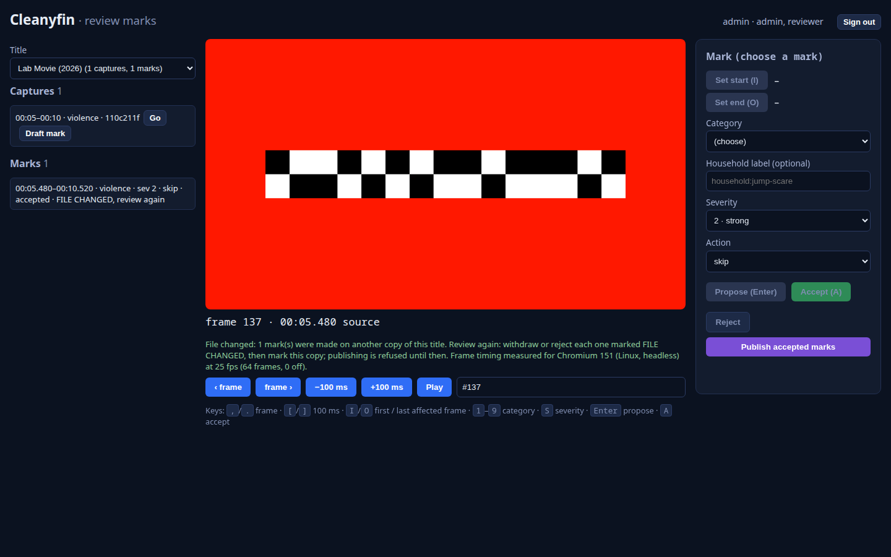

# Household file binding: tying reviewed marks to one exact copy of a movie

**ADOPTED · 2026-11-24 · built on `feat/household-file-binding`.** Owner decision (question dialog, 2026-11-24): *"Right now marking can't go past the tap stage on your real movies, only on lab test files. What should I build next?"* → *"Real-movie file check (Recommended) — Make sure a real movie file is the exact copy you reviewed, so you can mark, review and approve on your own library."*

Before this, a mark could only be bound to an operator-pinned lab file; on a household movie, drafting and publishing refused with `UnverifiedBinding`. Now any ordinary local video file in a Jellyfin library can be bound, and the lab fixture is checked by the same rule.

## 1. What has to be true

A filtered playback is right only if **the bytes the viewer plays are the bytes the reviewer reviewed, read on the same timeline.** Neither a title, a runtime, a file size, an OSHash nor a modification time establishes that ([principle 7](../../../.claude/12-PRINCIPLES.md), [delivery pattern](../../../.claude/13-DELIVERY-PATTERN.md)). A same-size, same-duration re-download with a preserved mtime passes all of them.

## 2. The rule: an edition

| Part | What it is | Why |
|---|---|---|
| **Bytes** | Full SHA-256 of the whole file, read once in the background | The only cheap-to-state proof of "same bytes". No sampling: a changed scene in the middle must count. |
| **Timeline** | The stream layout from the server's own ffprobe, run on those bytes: container format, start, duration, and for every stream its index, kind, codec, time base and first timestamp | The same bytes read by a different demuxer can start at a different time. The plan's track anchors come from here: source zero is the earliest audio/video first timestamp; each stream is anchored at its own first timestamp, which must lie a whole millisecond after zero, or the file is refused (`UnsupportedSourceClock`) rather than rounded. |
| **Edition digest** | `sha256("edition-v1|" + bytes SHA-256 + "|" + layout SHA-256)` | Changes if either changes. Written into the snapshot's `bindingRev` as `bind:<item>:<edition digest>`; `timelineRef` is `clock:<item>:<layout digest>`. |
| **Proof stays valid while** | The file's change signals are exactly those the hash was taken under: inode, size, mtime (ns) and **ctime** (ns), read with `statx`, plus the same item, media source and path | ctime is set by the kernel on every write, truncate, rename, link or metadata change, and ordinary programs cannot set it back, so "mtime preserved" edits are visible. Device/mount ids are left out: they change on every remount and container restart, which would re-hash a whole library after each reboot without adding a signal ctime does not already give. |

**No schema change for snapshots or plans.** `annotation-snapshot-v1` already carries full SHA-256, size, duration, timeline ref, binding rev and track clocks. One new, household-private record stores the proof so a 40 GB file is hashed once, not after every restart: [`edition-record-v1`](../../../delivery/schema/edition-record-v1.schema.json) (path, signals, SHA-256, layout, layout digest). It never leaves the server and holds no media.

## 3. How it runs

```text
use (review page, draft, publish, filtered playback)
   └─ cheap check: statx(path) == record.stamp ?  ── yes ─> verified edition (microseconds)
                                                    └─ no ──> refuse VerificationPending, queue one background job
background job (one file at a time, below-normal priority, optional pace EditionHashBytesPerSecond)
   └─ open → statx(handle) == statx(path) → ffprobe → SHA-256 in 256 KiB chunks → statx again on handle and path
        └─ all equal ─> write edition-record-v1 (atomic) ; changed mid-read ─> try again on next use
```

- **Nothing waits for a hash.** Requests return at once with `VerificationPending`; the review page shows "Checking that this is the exact file being reviewed 45%…" and polls. Lab: every status request during the check answered in under 130 ms.
- **One implementation, two verifiers.** `IEditionVerifier` has two implementations: `PinnedAsset` (lab: individually mounted read-only inode ≤ 64 MiB, hashed in the request, exact fixture layout only) and `HouseholdEditions` (any local single-file video in a library, background hash). Both produce the same `EditionRecord`, digest and binding; `ShelfStore`, `FixtureGate` and the marking service use one router (`Editions`).
- **Re-verified at play time.** Every filtered `PlaybackInfo`, every list and every byte-range request re-resolves the plan, which re-runs the cheap check. A changed signal refuses the outstanding offer immediately (the grant is revoked), before any re-hash.
- **Jellyfin's catalogue must agree.** Jellyfin's own probe of the item (size, runtime within 1 ms, audio/video stream indexes) must match the verified layout; a stale catalogue refuses (`BindingMismatch`) until the library is rescanned. The bytes always win over the catalogue, never the other way.

## 4. What invalidates a binding, and what the household sees

| Event | What happens | What the household sees |
|---|---|---|
| Touch, `chmod`, new hard link, metadata-only tool | Signals change → offers refused at once → re-hash → **same edition** → the same filtered item is kept and plays again | A few seconds (≈ size ÷ disk speed) of "checking this file"; the filtered title is not playable during it, then plays again |
| Replace (same name/size/duration, mtime kept), in-place edit, re-encode, other cut | Signals change → refused at once → re-hash → **new edition** → old snapshot no longer matches → filtered item **withdrawn** | Marks stay on the old edition, labelled **"FILE CHANGED, review again"**; publishing refuses (`FileChanged`) until each is withdrawn or rejected; new marks bind to the new file. Never moved across, never unfiltered |
| Same bytes read as a different timeline (ffprobe upgrade) | New layout digest → new edition | As above: review again |
| Rename or move | Different path → not current; Jellyfin usually gives the moved file a new item id | The old item's marks show as changed; the moved file is a new title to mark (no automatic carry-over, R04/§1 of the marking design) |
| File unreadable, remote, `.strm`, multi-part, alternate versions, external audio track files, ISO/disc folder, live stream | Not bindable (their bytes are not one hashed file) | `UnverifiedBinding` with the reason on the review page |
| Stream starts not on one millisecond clock (e.g. AAC priming of −1024/48000 s) | Refused, not rounded | `UnsupportedSourceClock`; marks cannot be placed on that file |

The household never gets an unfiltered fallback in place of a filtered title. An original is a separate item they choose separately.

## 5. Limits stated plainly

- **Proof against accidents and ordinary tools, not against the administrator.** Whoever controls the disk can change a file and restore its ctime (`debugfs`, a changed clock, a crafted filesystem). A network filesystem reports whatever the NAS says; a NAS that preserves ctime across a content change would defeat the cheap check. Same threat model as the audit log.
- **Cost.** One full read of every marked title, once, plus a re-read after any signal change. See the ledger row for measured throughput.
- **Playback is still offered only for a measured layout.** Binding works for any file with an exact clock; filtered playback additionally needs a measured evidence tuple. The plugin now derives the tuple's layout from the verified file (container, every track's codec, depth, range, geometry, rate, channels, clock anchor and the track that plays), so the register decides; see [common formats](../common-formats-2026-11-24/01-common-formats.md) for which layouts measured exact. The household lab case uses the hard fixture's bytes at an ordinary library path.

## 6. Evidence

`dotnet test tests/Delivery.Contract.Tests --filter Category=Edition` (identity, record round trip and schema, replace same size/duration, in-place edit with mtime preserved, touch, hard link, rename/move, re-encode, timeline-only change, change during hashing, pacing, clock anchors, refusals) and `Category=Marking` (publish refuses `FileChanged`; nothing carried across). `python3 tools/playback-lab/check-plugin.py --case household-binding --jellyfin 10.11|12.4`: ordinary folder-mounted file checked in the background with progress, marker drafts, reviewer refines frame-exactly in a headless browser, accepts, publishes, mpv plays the filtered item sample-exact; touch keeps it; same-size/same-duration replacement withdraws it and the review page says "review again".


